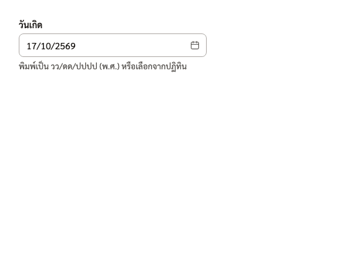
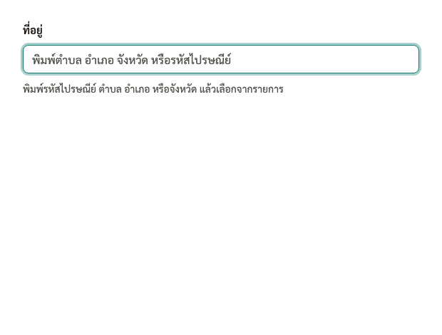

# react-thai

**คอมโพเนนต์ React สำหรับฟอร์มภาษาไทย: ตัวเลือกวันที่แบบ พ.ศ. และช่องกรอกที่อยู่ที่เติมให้อัตโนมัติ เน้นการเข้าถึง (accessibility)**

[English](./README.md) · [Storybook](https://tonklasocute.github.io/react-thai) · [Changelog](./CHANGELOG.md)

[](https://www.npmjs.com/package/react-thai)
[](https://github.com/tonklasocute/react-thai/actions/workflows/ci.yml)
[](./LICENSE)
[](https://tonklasocute.github.io/react-thai)

| ThaiDatePicker                                                       | ThaiAddressInput                                               |
| -------------------------------------------------------------------- | -------------------------------------------------------------- |
|  |  |

- **ThaiDatePicker / ThaiDateRangePicker**: ผู้ใช้เห็นและพิมพ์ปี พ.ศ. (`17/10/2569`) ส่วนโค้ดของคุณได้ `Date` ธรรมดา แบ็กเอนด์จึงไม่ต้องรับปี 2569
- **ThaiAddressInput**: พิมพ์รหัสไปรษณีย์ ตำบล/แขวง อำเภอ/เขต หรือจังหวัด แล้วเลือกจากรายการ ระบบจะเติมให้ครบทั้ง 4 ช่อง โดยใช้ แขวง/เขต สำหรับกรุงเทพฯ และ ตำบล/อำเภอ สำหรับจังหวัดอื่น ข้อมูล 7,436 ตำบลโหลดแบบ lazy จึงไม่เพิ่มขนาด bundle หลัก
- **ThaiIdInput, ThaiPhoneInput, BahtText**: ตัวช่วยจัดรูปแบบ ตรวจความถูกต้อง และแปลงตัวเลขเป็นคำอ่านภาษาไทย
- มี hook แบบ headless, ธีม CSS variables (รองรับ dark mode), `"use client"` สำหรับ Next.js และไม่มี runtime dependency

## ติดตั้ง

```bash
npm install react-thai
```

ต้องใช้ `react` และ `react-dom` เวอร์ชัน 18 หรือ 19 ส่วน `zod` (3.23+ หรือ 4) ไม่บังคับ ใช้เฉพาะกับ `react-thai/zod`

## เริ่มใช้งานใน 30 วินาที

```tsx
import { useState } from 'react';
import { ThaiDatePicker, toISODate } from 'react-thai/date-picker';
import { ThaiAddressInput, type ThaiAddress } from 'react-thai/address';
import 'react-thai/styles.css'; // ธีมเริ่มต้น (ไม่บังคับ)

export function Example() {
  const [birthday, setBirthday] = useState<Date | null>(null);
  const [address, setAddress] = useState<ThaiAddress | null>(null);
  return (
    <>
      <ThaiDatePicker label="วันเกิด" value={birthday} onChange={setBirthday} />
      <ThaiAddressInput label="ที่อยู่" value={address} onChange={setAddress} />
      <p>{birthday && toISODate(birthday)}</p> {/* "2026-10-17" */}
    </>
  );
}
```

## ThaiDatePicker

- พิมพ์ `17102569` ช่องจะจัดรูปแบบเป็น `17/10/2569` ให้ระหว่างพิมพ์ พิมพ์เลขไทยก็ได้
- วันที่ที่ไม่มีจริง เช่น `29/02/2569` (ปี 2569 = ค.ศ. 2026 ไม่ใช่ปีอธิกสุรทิน) หรือ `31/04/2569` จะขึ้น error และ `onChange(null)` แทนที่จะเลื่อนไปเป็นวันอื่น
- `onChange` ได้ `Date` เวลาเที่ยงคืนตามเวลาท้องถิ่น ไม่มีการแปลงผ่าน UTC เลย เวลาส่งไป API ให้ใช้ `toISODate(date)` อย่าใช้ `toISOString()`
- `name="birthday"` จะเพิ่ม hidden input ที่ส่งค่าแบบ `YYYY-MM-DD` (ค.ศ.) ไปกับ `<form>` ปกติ
- props หลัก:
  - `locale` (`th`/`en`), `era` (`BE`/`CE`), `digits` (`arabic`/`thai`)
  - `minDate`, `maxDate`, `isDateDisabled`, `weekStartsOn`, `showTodayButton`, `closeOnSelect`
  - `open`/`defaultOpen`/`onOpenChange`, `placement`
  - `label`, `hint`, `error`, `labels`, `className`/`classNames`

  ดูตาราง props แบบเต็มใน [README ภาษาอังกฤษ](./README.md#thaidatepicker)

```tsx
<ThaiDatePicker
  label="วันนัดหมาย"
  minDate={new Date()}
  isDateDisabled={(d) => d.getDay() === 0 || d.getDay() === 6} // ปิดเสาร์-อาทิตย์
  digits="thai"
/>
```

**ThaiDateRangePicker**: ใช้ค่าเป็น `{ from, to }` มี `startName`/`endName` สำหรับ hidden input และ `numberOfMonths` (ค่าเริ่มต้น 2)

**useThaiCalendar**: hook แบบ headless สำหรับสร้างปฏิทินหน้าตาของคุณเอง โดยได้พฤติกรรมคีย์บอร์ดตาม WAI-ARIA มาครบ

## ThaiAddressInput

```tsx
<ThaiAddressInput
  label="ที่อยู่จัดส่ง"
  fields="split" // 4 ช่องแบบฟอร์มไทยทั่วไป หรือ "search" (ค่าเริ่มต้น) ช่องค้นหาเดียว
  onChange={(a) => console.log(a)}
/>
```

ค่าที่ได้เป็น `{ subdistrict, district, province, postcode, isBangkok, subdistrictPrefix, districtPrefix, en? }`

การค้นหา:

- จับคู่ทั้งแบบขึ้นต้นด้วยคำค้นและแบบมีคำค้นอยู่ข้างใน ชื่อที่ตรงทั้งคำขึ้นก่อน
- คำค้นหลายคำต้องตรงทุกคำ
- ไม่สนใจคำนำหน้าที่พิมพ์มา เช่น `ต.`, `อ.`, `จ.` และพิมพ์ `กทม` แทนกรุงเทพมหานครได้
- ไฮไลต์ส่วนที่ตรงกับคำค้น

ข้อมูลภาษาไทยมีขนาด 58 kB gzip และโหลดเมื่อผู้ใช้โฟกัสช่องครั้งแรก ถ้าต้องการชื่อภาษาอังกฤษ ให้ใส่ `includeEnglish` (เพิ่มอีก 32 kB gzip)

**useThaiAddress**: hook แบบ headless ที่มี `search(query, { field, limit })`, `lookupPostcode(postcode)` และ `status`

## ตัวช่วยอื่นๆ

```tsx
<ThaiIdInput label="เลขประจำตัวประชาชน" onChange={(digits, { valid }) => {}} />
// แสดง 1-1017-00203-45-0 และตรวจเลขหลักสุดท้าย (check digit)

<ThaiPhoneInput label="เบอร์มือถือ" type="mobile" output="e164" />
// 081-234-5678 → "+66812345678", เบอร์บ้าน 02-123-4567, 053-123-456

<BahtText value={1234.5} /> // หนึ่งพันสองร้อยสามสิบสี่บาทห้าสิบสตางค์
```

`react-thai/validators` เป็นฟังก์ชันล้วนที่ใช้บนเซิร์ฟเวอร์ได้: `isValidThaiId`, `isValidThaiPhone`, `toE164`, `isValidThaiPostcode`, `bahtText` และอื่นๆ

## react-hook-form + zod

ทุกคอมโพเนนต์ส่งต่อ `ref` และรับ `value`/`onChange`/`onBlur`/`name` จึงใช้ `{...field}` จาก `Controller` ได้ทันที

```tsx
import { thaiIdSchema, thaiMobileSchema, thaiAddressSchema } from 'react-thai/zod';

const schema = z.object({
  citizenId: thaiIdSchema,
  phone: thaiMobileSchema,
  birthday: z.date({ message: 'กรุณาระบุวันเกิด' }),
  address: thaiAddressSchema.nullable().refine((v) => v !== null, 'กรุณาเลือกที่อยู่'),
});

<Controller
  name="birthday"
  control={control}
  render={({ field, fieldState }) => (
    <ThaiDatePicker label="วันเกิด" {...field} error={fieldState.error?.message} />
  )}
/>;
```

## Next.js

- คอมโพเนนต์ที่ต้องโต้ตอบกับผู้ใช้มี `"use client"` อยู่แล้ว จึงใช้ใน Server Component ได้ทันที (ส่งได้เฉพาะ props ที่ serialize ได้) ถ้าต้องส่ง callback ให้สร้างไฟล์ `"use client"` ของคุณเองมาครอบ
- `react-thai/validators`, `react-thai/zod` และ `react-thai/baht-text` ใช้บนเซิร์ฟเวอร์ได้ ทั้งใน Server Component, Route Handler และ Server Action
- ระหว่าง render ไม่มีการอ่าน `window` จึงใช้กับ SSR ได้อย่างปลอดภัย ดูตัวอย่างได้ที่ [`examples/nextjs`](./examples/nextjs)

## ปรับแต่งธีม

```css
:root {
  --rt-accent: #6d28d9;
  --rt-radius: 1rem;
  --rt-font: 'Sarabun', sans-serif;
}
```

- dark mode เปลี่ยนตาม `prefers-color-scheme` อัตโนมัติ ถ้าต้องการบังคับ ให้ใส่ `data-theme="dark"` ที่ element แม่
- ใช้กับ Tailwind ได้ผ่าน `className`/`classNames` ธีมอยู่ใน cascade layer ชื่อ `react-thai` ดังนั้นให้ประกาศ `@layer react-thai;` ไว้ก่อน `@import 'tailwindcss';` เพื่อให้ utility ของ Tailwind ชนะธีม

## ข้อมูลที่อยู่

|             |                                                                                  |
| ----------- | -------------------------------------------------------------------------------- |
| แหล่งข้อมูล | [kongvut/thai-province-data](https://github.com/kongvut/thai-province-data)      |
| สัญญาอนุญาต | MIT © Kongvut Sangkla ([THIRD_PARTY_NOTICES.md](./THIRD_PARTY_NOTICES.md))       |
| เวอร์ชัน    | tag `v3.1.0` (commit `7d689e4`) สร้างเมื่อ 2026-10-19                            |
| ครอบคลุม    | 77 จังหวัด, 930 อำเภอ/เขต, 7,436 ตำบล/แขวง, 966 รหัสไปรษณีย์ พร้อมชื่อภาษาอังกฤษ |

ข้อจำกัด: dataset นี้ให้ตำบลละ 1 รหัสไปรษณีย์ แต่บางตำบลใช้มากกว่า 1 รหัส ถ้าต้องการความแม่นยำระดับนั้น ควรให้ผู้ใช้แก้รหัสไปรษณีย์เองได้

## การเข้าถึง (Accessibility)

- **date picker** ทำตามรูปแบบ WAI-ARIA date picker dialog
  - ลูกศรเลื่อนทีละวัน/สัปดาห์, Home/End ไปต้น/ท้ายสัปดาห์, PageUp/PageDown เปลี่ยนเดือน, Shift+PageUp/PageDown เปลี่ยนปี
  - Enter/Space เลือกวัน, Esc ปิดปฏิทินแล้วคืน focus ให้ช่องกรอก
- **ช่องที่อยู่** ทำตามรูปแบบ WAI-ARIA combobox (`aria-activedescendant`) และประกาศจำนวนผลลัพธ์ให้โปรแกรมอ่านหน้าจอ
- CI ตรวจทุก story ด้วย axe

## ขนาด bundle (gzip)

|                                         | ขนาด               |
| --------------------------------------- | ------------------ |
| ThaiDatePicker                          | 7.7 kB             |
| ThaiAddressInput (เฉพาะโค้ด)            | 4.6 kB             |
| ThaiIdInput / ThaiPhoneInput / BahtText | 1.9 / 2.1 / 0.9 kB |
| ข้อมูลที่อยู่ภาษาไทย (lazy)             | 58.3 kB            |

## สัญญาอนุญาต

[MIT](./LICENSE) © Khomkrit Daengnuan
